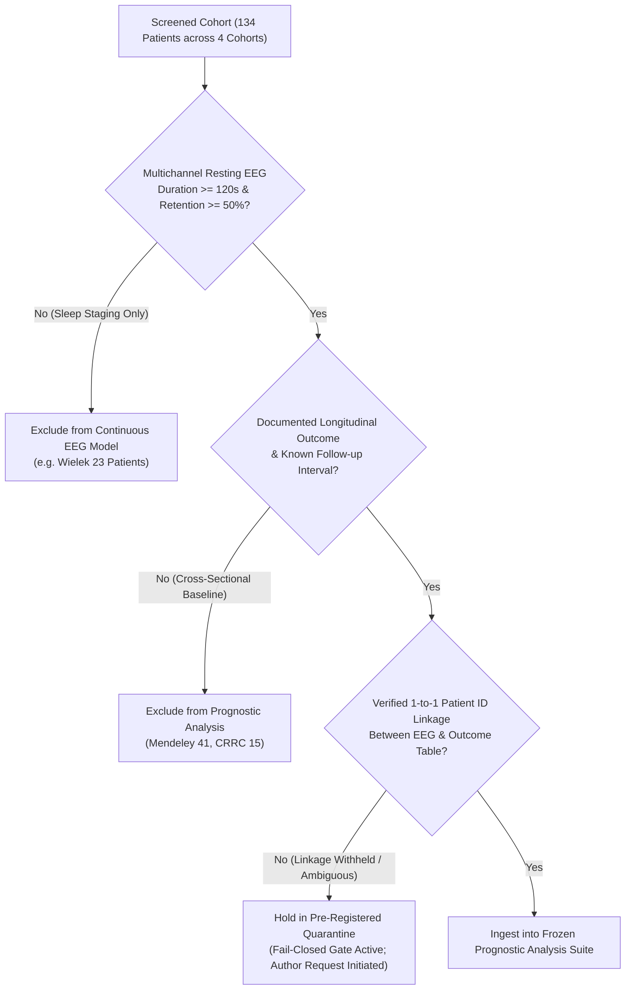

# Research Protocol: Prognostic Validation of Frozen Baseline EEG Temporal Scores for DoC Functional Recovery

**Protocol ID**: `DOC-PROGNOSTIC-v1.0.0`  
**Date**: October 27, 2026  
**Status**: Pre-Registered & Frozen Before Ingestion of Subject-Level Outcomes  
**Machine-Readable Specification**: [`docs/research_protocols/prognostic_validation_protocol_v1.json`](file:///D:/DoC_Hierarchy_Validation/docs/research_protocols/prognostic_validation_protocol_v1.json)  
**Frozen Model State Hash (SHA-256)**: `e0d608e05f23bdabd7a1f45610adefad10785b03898f1b8daa126e9c7140fb6a`  

---

## 1. Rationale & Core Research Question

In cross-sectional evaluations of disorders of consciousness (DoC), functional stratification distinguishes patients diagnosed with Minimally Conscious State (MCS) from those in a Vegetative State / Unresponsive Wakefulness Syndrome (VS/UWS). However, from a neurological and rehabilitative standpoint, the critical question is whether baseline physiological dynamics reflect **recovery potential** beyond current behavioral capability.

### Core Scientific Question:
> *Does the frozen baseline EEG temporal score $S(\mathbf{x})$, derived from orthogonal temporal dynamics, contain statistically significant incremental prognostic information regarding long-term functional recovery, after adjusting for baseline clinical diagnosis and Coma Recovery Scale-Revised (CRS-R) total scores?*

---

## 2. Eligibility Criteria & Patient Selection Flow

### Inclusion Criteria:
1. Confirmed diagnosis of prolonged DoC (VS/UWS or MCS) at baseline evaluation.
2. Artifact-screened resting-state multichannel EEG recording of $\ge 120\text{ s}$ duration with valid epoch retention $\ge 50\%$.
3. Formal follow-up evaluation conducted at a specified time horizon (e.g., 6 months) using an established functional scale (e.g. Glasgow Outcome Scale, GOS, or CRS-R emergence).
4. **Verified, unambiguous 1-to-1 subject identity linkage** between the raw EEG recording file and the clinical follow-up record.

### Exclusion Criteria:
1. Absence of verified subject-level linkage table in the public domain.
2. Identity collision or ambiguity (e.g. duplicate baseline CRS-R and diagnosis preventing definitive matching).
3. Post-hoc outcome imputation: Missing follow-up cannot be coded as non-recovery.

---

## 3. Pre-Specified Outcome Encoding

### Figshare Cohort (Ling et al., 2024):
- **Horizon**: Exactly 6 months post-baseline EEG acquisition.
- **Scale**: Glasgow Outcome Scale (GOS, 1 to 5).
- **Binary Outcome Split**:
  - **Favorable Recovery ($Y = 1$)**: $\text{GOS} \ge 4$ (Moderate Disability or Good Recovery).
  - **Unfavorable Outcome ($Y = 0$)**: $\text{GOS} < 4$ (Severe Disability, Vegetative State, or Death).
- **Prohibition**: No alternative thresholds (e.g., GOS $\ge 3$) may be explored post-hoc.

### Wielek Cohort (PLOS ONE 2018):
- **Horizon**: Heterogeneous (1 to 150 months).
- **Statistical Structure**: Right-censored time-to-event survival models (Cox proportional hazards and Kaplan-Meier) or separate horizon stratification.
- **Outcome Split**:
  - **Favorable**: Recovery of functional consciousness / emergence (eMCS, SD).
  - **Unfavorable**: Persistent UWS or Death.
  - **Missing**: Censored or excluded; strictly not coded as unfavorable.

---

## 4. Frozen Model Specification & Parameters

All prognostic analyses will utilize the frozen weights, scalers, and improper linear model parameters serialized in `results/matched_model_comparison_v1/fitted_states.json` (`figshare50/orthogonal_lag1/source_frozen`):

- **Feature Suite**:
  1. $c_{\text{global}}$: Global spatial coordination (mean pairwise Pearson correlation of band powers across clean blocks).
  2. $-\mathrm{CV}_\theta$: Theta amplitude regularity (negative coefficient of variation of theta power).
  3. $\rho_1$: Directional persistence (lag-1 autocorrelation of global power difference under $\mathbb{I}_{\text{adj}}=1$).
  4. $r_{\text{residual}}$: Residual interhemispheric coordination (bilateral covariance after regressing global mode).
- **Frozen Source-Domain Parameters**:
  - Means: $\boldsymbol{\mu} = [0.451091, -1.661900, 0.334660, 0.334171]$
  - Standard Deviations: $\boldsymbol{\sigma} = [0.227874, 1.565074, 0.211388, 0.177284]$
  - Orientation Signs: $\mathbf{s} = [+1.0, +1.0, +1.0, -1.0]$
- **Frozen Linear Combinations**:
  $$S(\mathbf{x}) = \frac{1}{4} \sum_{k=1}^4 s_k \frac{x_k - \mu_k}{\sigma_k}$$
  $$S_{1.5}(\mathbf{x}) = \frac{1}{4} \sum_{k=1}^4 \text{clip}\left(s_k \frac{x_k - \mu_k}{\sigma_k}, -1.5, 1.5\right)$$
- **Fixed Operating Threshold**:
  - Population Neutral Threshold: $\theta_0 = +0.0451$
  - Prioritization Threshold: $\theta_{\text{prioritize}} = +0.0725$
  - *No post-hoc tuning on test outcomes is permitted.*

---

## 5. Pre-Specified Statistical Hypotheses & Tests

1. **Hypothesis 1 (Distributional Separation)**:
   - Does baseline $S(\mathbf{x})$ differ significantly between patients with favorable vs unfavorable long-term outcomes?
   - Test: Two-sided Mann-Whitney $U$ test.
2. **Hypothesis 2 (Prognostic Effect Size)**:
   - What is the Odds Ratio (OR) per 1-SD increase in baseline $S(\mathbf{x})$ for 6-month favorable recovery?
   - Model: Univariate Logistic Regression (or Firth's penalized logistic regression if small-sample separation occurs).
3. **Hypothesis 3 (Incremental Value Beyond Baseline CRS-R)**:
   - Does adding baseline EEG score $S(\mathbf{x})$ improve outcome prediction over baseline CRS-R alone?
   - Model: Multivariable Logistic Regression:
     $$\text{logit}(P(Y=1)) = \beta_0 + \beta_1 \cdot \text{CRS-R} + \beta_2 \cdot S(\mathbf{x})$$
   - Test: Likelihood Ratio Test (LRT) comparing Full Model vs Nested Model ($\text{CRS-R}$ only).
4. **Hypothesis 4 (Decision Rule Diagnostic Accuracy)**:
   - Diagnostic Sensitivity, Specificity, Positive Predictive Value (PPV), and Negative Predictive Value (NPV) evaluated strictly at the pre-specified threshold $\theta_0 = +0.0451$.

---

## 6. Audit & Ethical Rules (Fail-Closed Gate)

- **Zero-Tolerance for Data Fabrication**: If subject-level linkage is unverified in the public domain, the software must refuse to emit prognostic statistics on unlinked patients.
- **Provenance Logging**: All outputs must log the source DOI, file hash, and pairing justification.
